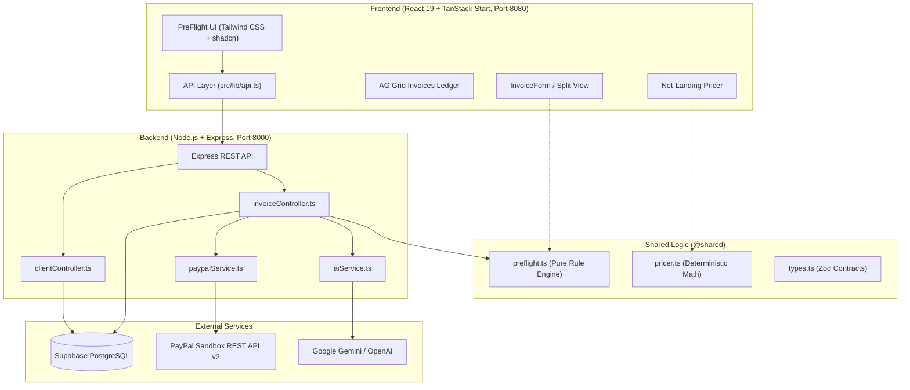

# PreFlight ✈️
### AI-Assisted Invoice Co-Pilot for Freelancers & Agencies
**PayPal AI Hackathon Submission** | Devpost

[](https://www.typescriptlang.org/)
[](https://react.dev/)
[](https://expressjs.com/)
[](https://supabase.com/)
[](https://developer.paypal.com/docs/api/invoicing/v2/)
[](https://ai.google.dev/)

---

## 📌 Executive Summary

**PreFlight** is an intelligent accounts-payable (AP) co-pilot designed for freelancers, contractors, and agencies invoicing international clients via **PayPal**. 

Before an invoice is dispatched, PreFlight validates the draft against the client's documented procurement rules, highlights blockers with verbatim evidence quotes, calculates true net payout after PayPal cross-border fees and FX spreads, and dispatches the live invoice through the **PayPal REST Invoicing API v2**.

---

## 🛑 The Problem: Why B2B Invoices Get Rejected

A solo freelancer completes weeks of work and sends an invoice. Weeks later, payment is stalled or rejected by the client's Accounts Payable (AP) department for avoidable administrative discrepancies:

* ❌ **Missing PO Reference:** Client policy mandates a Purchase Order number, but the invoice was sent without one.
* ❌ **Legal Entity Mismatch:** The invoice was addressed to *"Acme Corp"* instead of the registered legal entity *"Acme Corporation Ltd"*.
* ❌ **Currency Mismatch:** Invoicing in EUR when the client's regional subsidiary only disburses USD.
* ❌ **Missing Tax / VAT ID:** Missing contractor tax identification or VAT registration numbers.
* ❌ **Mismatched Payment Terms:** Stating "Due Upon Receipt" when vendor onboarding stipulated "Net 30".
* ❌ **Wrong Recipient:** Sending directly to the project manager instead of the designated AP intake inbox (`ap@client.example`).
* ❌ **Surprise Fee Losses:** Freelancers quote $1,000 but receive ~$950 after cross-border PayPal processing fees and currency conversion deductions.

Freelancers have no in-house accountants to review their paperwork, leading to delayed payments, uncomfortable client disputes, and cash-flow bottlenecks.

---

## 💡 The PreFlight Solution

PreFlight introduces a flight-check methodology for billing:

```
  +----------------------+      +----------------------+      +----------------------+
  |  1. Ingest AP Guide  | ---> | 2. Pre-Flight Check  | ---> |   3. PayPal Send     |
  |  AI extracts rules   |      | Deterministic engine |      | Real-time invoice    |
  |  & evidence quotes   |      | blocks invalid data  |      | with sandbox link    |
  +----------------------+      +----------------------+      +----------------------+
                                           |
                                           v
                                +----------------------+
                                |  Net-Landing Pricer  |
                                | Transparent fees & FX|
                                +----------------------+
```

1. **AP Document Ingestion:** Upload vendor onboarding guides or paste policy emails. AI extracts formal requirements, backed by exact verbatim quotes.
2. **Rule Enforcement:** A deterministic pre-flight engine validates invoice drafts against rules in real time. **Hard blockers prohibit sending; warnings advise improvements.**
3. **Net-Landing Fee Engine:** Transparently computes the exact gross invoice total needed to land a target net payout after PayPal fees and FX conversions.
4. **PayPal REST Invoicing API v2 Integration:** Dispatches invoices directly to PayPal Sandbox, generating genuine payment links (`payer_view_url`) and tracking invoice lifecycles.

---

## ✨ Key Features

### 1. 🏢 Clients (AP Rule Engine)
* **Document Ingestion:** Upload PDF vendor guides or paste onboarding policy text.
* **Verbatim Evidence Quotes:** AI extracts rules and pairs each with an exact quote from the document for complete transparency.
* **Rule Taxonomy:**
  * PO number mandatory/optional
  * Exact legal entity name match
  * Allowed currencies (`USD`, `EUR`, etc.)
  * Strict payment terms (`Net 15`, `Net 30`, `Net 45`)
  * Designated AP email address
  * Single-invoice-per-PDF requirements
* **Editable Rules:** Users can override any extracted rule directly from the interface. Changes persist in real-time to Supabase (`source = 'user'`).
* **Continuous Learning:** Paste rejection emails to automatically learn new rules and mark them with a "New" badge.

### 2. 📝 New Invoice (Pre-Flight Validator & PayPal Dispatch)
* **Natural Language One-Line Drafter:** Type `"Invoice Acme Corp $1,200 for frontend refactor"` to auto-populate the draft invoice.
* **Dual-Column Split View:** Real-time form on the left, live Pre-Flight validation panel on the right.
* **Three-Tier Issue Classification:**
  * 🔴 **Blockers (PF-01 to PF-04):** Prohibit invoice sending (Send button locked; server returns HTTP 422 if bypassed).
  * 🟡 **Warnings (PF-05 to PF-06):** Soft alerts (e.g., payment term deviations, vague line item descriptions).
  * 🟢 **Passed Checks:** Positive confirmation of compliant fields.
* **One-Click Quick Fixes:** Fix blockers instantly with inline buttons (e.g., "Add PO", "Use legal name", "Switch to USD").
* **AI AP Co-Pilot:** Evaluates deliverable descriptions to flag vague scopes that typically trigger manual client audits.
* **PayPal Dispatch:** On clearance, generates an official PayPal Sandbox invoice, returning the `paypal_invoice_id` and a live `payer_view_url`.

### 3. ⚖️ Net-Landing Pricer
* **Predictable Take-Home Pay:** Solve the equation: *"I need exactly $1,000 in my local account—what must I invoice the client?"*
* **Separate Fee & FX Breakdown:** Delineates PayPal domestic/international payment processing fees from cross-currency conversion spreads.
* **Customizable Fee Schedule:** Transparent rates table allowing users to adapt calculations to specific merchant tiers.
* **One-Click Transfer:** Instantly ports the computed gross amount into a new invoice draft.
* **Deterministic Code Math:** Adheres to **NFR-01**—all financial math is executed in pure, unit-tested TypeScript. No LLM output touches currency figures.

### 4. 📊 Invoices (Live Supabase & PayPal Ledger)
* **Live Database Sync:** Connected directly to Supabase PostgreSQL (`invoices` and `invoice_items` tables).
* **Real PayPal Sandbox Links:** Every row binds to the genuine `payer_view_url`. Clicking **Payer link** opens the interactive PayPal sandbox payment interface.
* **Interactive Status Management:** Mark invoices as Paid with one click to simulate the `INVOICING.INVOICE.PAID` lifecycle event.
* **KPI Metrics:** Dynamic summary cards for **Draft**, **Sent (unpaid)**, **Paid**, and **Overdue** (derived at read-time).
* **Full AG Grid Experience:** Search by client or invoice number, filter by status, sort columns, and review pre-flight scores.

---

## 🏛️ System Architecture



### Pre-Flight Send Gate Pipeline

```
[ User Clicks Send ]
         │
         ▼
[ Client Validation (Zod) ]
         │
         ▼
[ POST /api/invoices/generate ]
         │
         ▼
[ Fetch Live Rules from Supabase ]
         │
         ▼
[ Run Server Pre-Flight Check (preflight.ts) ]
         │
    Blockers > 0? ─── YES ───► [ Return HTTP 422 BLOCKERS_PRESENT ]
         │
         NO
         ▼
[ Run Soft AI Heuristic Review (Gemini) ]
         │
         ▼
[ Create Draft Invoice in Supabase (status: draft) ]
         │
         ▼
[ Request OAuth2 Token: POST /v1/oauth2/token ]
         │
         ▼
[ Create Invoice: POST /v2/invoicing/invoices ]
         │
         ▼
[ Send Invoice: POST /v2/invoicing/invoices/{id}/send ]
         │
         ▼
[ Fetch Details: GET /v2/invoicing/invoices/{id} ]
         │
         ▼
[ Update Supabase with paypal_invoice_id & payer_view_url ]
         │
         ▼
[ Return HTTP 201 Created with Live Payment Link ]
```

---

## 🛠️ Tech Stack Matrix

| Domain | Technology | Purpose |
|---|---|---|
| **Frontend Framework** | React 19, TanStack Start, Vite | High-performance reactive UI with SSR support |
| **Routing & State** | TanStack Router, TanStack Query | Type-safe client routing and server-state caching |
| **Component Styling** | Tailwind CSS v4, shadcn/ui, Lucide Icons | Responsive UI design system |
| **Data Tables** | AG Grid Community (`ag-grid-react`) | High-density invoice ledger with sorting and filtering |
| **Backend Framework** | Node.js, Express (TypeScript) | Modular REST API on port 8000 |
| **Database** | Supabase (PostgreSQL) | Relational persistence for clients, rules, invoices, line items |
| **Payments Engine** | PayPal REST Invoicing API v2 | Sandbox invoicing, payment generation, status sync |
| **AI Co-Pilot** | Google Gemini / OpenAI | AP rule extraction, evidence parsing, line item heuristics |
| **Validation & Schemas** | Zod | End-to-end type safety between frontend, backend, and DB |
| **Testing** | Vitest | Unit tests for deterministic rule engines and pricer math |

---

## 🛡️ Core Architectural Principles

1. **NFR-01: Money Math is Deterministic Code:** No artificial intelligence model produces invoice totals, currency conversions, or fee calculations. All calculations are executed by pure TypeScript functions in `shared/pricer.ts` and verified with unit tests.
2. **NFR-02: Secrets Stay on the Server:** Sensitive credentials (`PAYPAL_CLIENT_SECRET`, `SUPABASE_SERVICE_ROLE_KEY`, `LLM_API_KEY`) reside exclusively in `backend/.env`. No `VITE_` prefixed secret is ever bundled to the client.
3. **Code Rules Block, AI Advises:** Rejections are only triggered by verifiable code rules (e.g. missing PO, entity mismatch). AI recommendations act strictly as advisory warnings.
4. **Shared Single Source of Truth:** `preflight.ts` and `pricer.ts` reside in a top-level `shared/` directory, imported identically by frontend and backend to guarantee zero discrepancy.

---

## 🗄️ Database Schema Overview (Supabase PostgreSQL)

```sql
-- 1. Clients
clients (
  id uuid primary key,
  name text not null,
  legal_entity text not null,
  ap_email text not null,
  industry text
);

-- 2. Client Documents
client_documents (
  id uuid primary key,
  client_id uuid references clients(id),
  kind text check (kind in ('pdf', 'text', 'email')),
  source_text text not null
);

-- 3. Extracted Requirements
requirements (
  id uuid primary key,
  client_id uuid references clients(id),
  key text not null,
  label text not null,
  value jsonb not null,
  evidence text not null,
  confidence text check (confidence in ('high', 'medium', 'low')),
  source text check (source in ('ai', 'user', 'email'))
);

-- 4. Invoices
invoices (
  id uuid primary key,
  invoice_number text unique not null,
  client_id uuid references clients(id),
  bill_to text not null,
  send_to text not null,
  currency text check (currency in ('USD', 'EUR')),
  total numeric(12, 2) not null,
  status text check (status in ('draft', 'sent', 'paid')),
  paypal_invoice_id text unique,
  payer_view_url text,
  preflight_summary jsonb
);

-- 5. Invoice Items
invoice_items (
  id uuid primary key,
  invoice_id uuid references invoices(id) on delete cascade,
  position int not null,
  description text not null,
  quantity numeric(10, 2) not null,
  unit_price numeric(12, 2) not null
);
```

---

## 🚀 Local Development Setup

### Prerequisites
* **Node.js** >= 18.0.0
* **npm** >= 9.0.0
* A **PayPal Developer** Sandbox account ([developer.paypal.com](https://developer.paypal.com/))
* A **Supabase** project ([supabase.com](https://supabase.com/))

---

### Step 1: Clone the Repository
```bash
git clone https://github.com/chinmayprakashjoshi-chinjo/preflight-invoice-check.git
cd preflight-invoice-check
```

---

### Step 2: Configure Environment Variables

#### Backend (`backend/.env`):
Create `backend/.env` based on `backend/.env.example`:
```env
PORT=8000
NODE_ENV=development
APP_BASE_URL=http://localhost:8000
DEMO_MODE=true

# Supabase
SUPABASE_URL=https://<your-project-id>.supabase.co
SUPABASE_SERVICE_ROLE_KEY=your_supabase_service_role_key

# PayPal Sandbox REST Invoicing API v2
PAYPAL_ENV=sandbox
PAYPAL_CLIENT_ID=your_paypal_sandbox_client_id
PAYPAL_CLIENT_SECRET=your_paypal_sandbox_client_secret
PAYPAL_INVOICER_EMAIL=your-facilitator@business.example.com

# LLM AP Co-Pilot (Gemini or OpenAI)
LLM_API_KEY=your_gemini_or_openai_api_key
LLM_MODEL=gemini-1.5-pro
```

#### Frontend (`frontend/.env`):
Create `frontend/.env` based on `frontend/.env.example`:
```env
# Point frontend to Express backend
VITE_USE_MOCKS=false
VITE_API_BASE_URL=http://localhost:8000
```

---

### Step 3: Initialize Database (Supabase)
Run the SQL scripts located in `backend/supabase/` within your Supabase SQL Editor:
1. `backend/supabase/schema.sql` (Creates tables, indexes, constraints, invoice sequence generator).
2. `backend/supabase/seed.sql` (Populates Acme, Northwind, Globex and extracted evidence).

---

### Step 4: Install Dependencies

```bash
# Root packages
npm install

# Backend packages
cd backend
npm install
cd ..

# Frontend packages
cd frontend
npm install
cd ..
```

---

### Step 5: Test the PayPal Integration
Verify your PayPal Sandbox API credentials before running the app:
```bash
npm run paypal:test
```
*Expected output: Fetches OAuth2 Access Token, creates a draft invoice, dispatches it, and returns the live `payer_view_url`.*

---

### Step 6: Start Development Servers

Open two terminal tabs:

**Terminal 1 (Backend - Port 8000):**
```bash
cd backend
npm run dev
```
*Backend runs on `http://localhost:8000` with health check at `http://localhost:8000/api/health`.*

**Terminal 2 (Frontend - Port 8080):**
```bash
cd frontend
npm run dev
```
*Frontend runs on `http://localhost:8080`.*

---

## 🎬 3-Minute Hackathon Demo Script

1. **The Problem:** Navigate to `/app/new-invoice`. Notice the pre-filled demo invoice for Acme Corporation Ltd with intentional errors (No PO, "Acme Corp" instead of "Acme Corporation Ltd").
2. **The Pre-Flight Gate:** The Right panel immediately shows **2 Blockers** with verbatim policy quotes from Acme's AP Guide. The "Send" button is locked.
3. **Quick-Fix Workflow:** Click **"Use legal name"** and **"Add PO"**. The blockers clear, the status badge turns green, and the button unlocks to **"Cleared for send"**.
4. **Live PayPal Dispatch:** Click **"Send via PayPal"**. The server re-validates the invoice, calls PayPal REST API v2, and displays a success modal containing the genuine PayPal Invoice ID and a clickable **Payer Link**.
5. **Real PayPal Sandbox Inspection:** Click the Payer Link to view the real sandbox invoice on `sandbox.paypal.com`.
6. **Live Rule Modification:** Go to `/app/clients`, open Acme's rules, and toggle "PO number on invoice" to *Not required*. Save. Return to `/app/new-invoice`—notice that an invoice without a PO now clears without blockers!
7. **Live Ledger:** Go to `/app/invoices` to inspect the full list of generated sandbox invoices loaded directly from Supabase. Click **"Mark paid (sandbox)"** to simulate webhook payment clearance.

---

## 🧪 Test Suite Execution

Run automated unit and integration tests:

```bash
# Frontend Unit Tests (Preflight rules, Pricer math, Route tests)
cd frontend
npm test

# Backend TypeScript Verification
cd backend
npm run typecheck
```

---

## 👥 Hackathon Team

* **Chinmay Prakash Joshi** ([@chinmayprakashjoshi-chinjo](https://github.com/chinmayprakashjoshi-chinjo)) - Full-Stack Architecture, PayPal API Integration, UI/UX & AI Co-Pilot.

---

## 📜 License & Compliance

Built for the **PayPal AI Hackathon on Devpost**. 
Distributed under the MIT License. All PayPal REST API references comply with official PayPal Developer documentation for Invoicing API v2.
